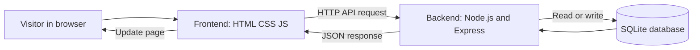
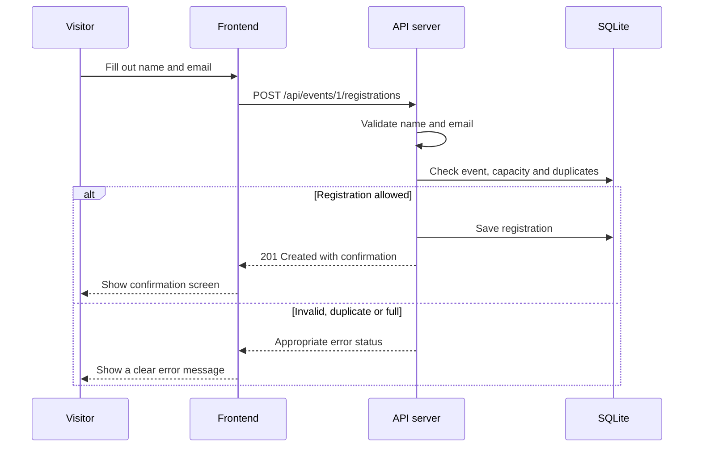

# Week 1: API flow

An API is how the website's frontend asks its backend for event data or sends registration details.

## Planned endpoints
| Method | Endpoint | Purpose |
| --- | --- | --- |
| `GET` | `/api/events` | Return upcoming events |
| `GET` | `/api/events/:id` | Return details of one event |
| `POST` | `/api/events/:id/registrations` | Register a visitor for an event |

## System diagram


## Registration request flow


## Example request (planned)
```http
POST /api/events/1/registrations
Content-Type: application/json

{
  "full_name": "Example Attendee",
  "email": "attendee@example.com"
}
```

## Example successful response (planned)
```json
{
  "registration_id": 101,
  "event_id": 1,
  "message": "Registration successful"
}
```

## Error cases to handle during implementation
- `400 Bad Request`: Missing or invalid details.
- `404 Not Found`: Event does not exist.
- `409 Conflict`: Duplicate registration or no seats left.

The registration save and capacity check should be protected against simultaneous requests when implemented. Nothing here claims the API is running yet.
