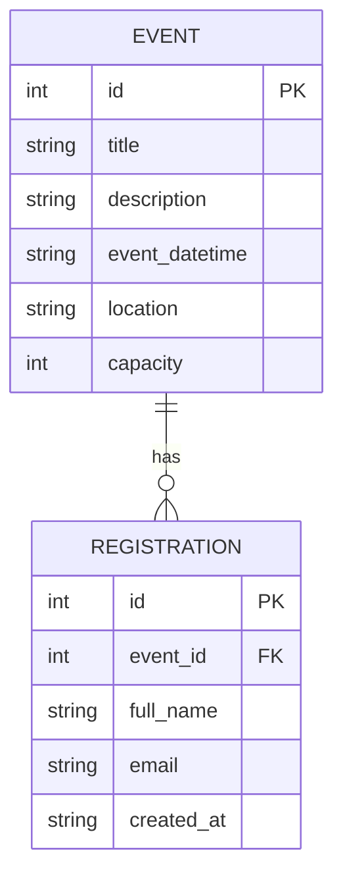

# Week 1: Data model

A minimal event registration system needs two entities: `Event` and `Registration`.

## Event
| Field | Example type | Purpose |
| --- | --- | --- |
| `id` | INTEGER (primary key) | Unique event ID |
| `title` | TEXT | Event name |
| `description` | TEXT | Event summary |
| `event_datetime` | TEXT (ISO 8601) | Scheduled date and time |
| `location` | TEXT | Event venue |
| `capacity` | INTEGER | Maximum attendees |

## Registration
| Field | Example type | Purpose |
| --- | --- | --- |
| `id` | INTEGER (primary key) | Unique registration ID |
| `event_id` | INTEGER (foreign key) | Links the registration to an event |
| `full_name` | TEXT | Attendee name |
| `email` | TEXT | Attendee email |
| `created_at` | TEXT (ISO 8601) | Time the registration was created |

## Relationship
One event can have many registrations. Each registration belongs to exactly one event.

## Planned data rules
- Require valid `full_name` and `email` values.
- Prevent multiple registrations with the same `email` for the same `event_id`.
- Reject registration when the event is full.
- Never expose the full registration list through a public API.
- Validate rules on the server, not only in the browser.

This is a design, not an implemented database schema.
