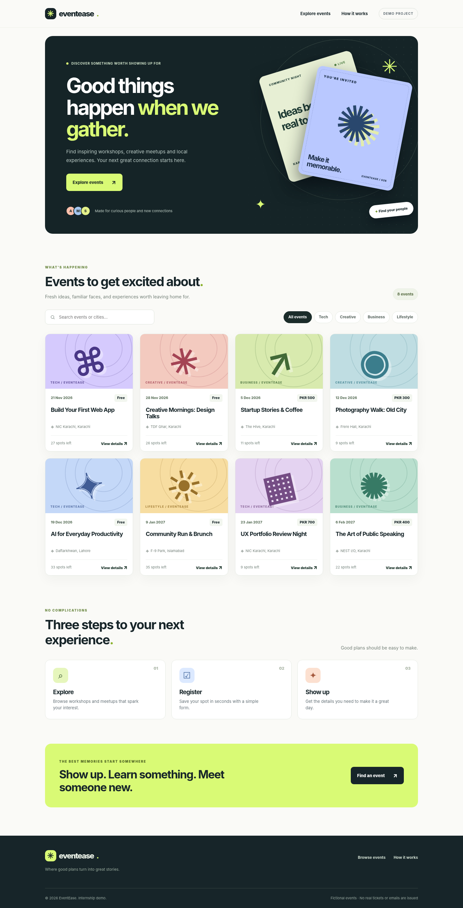
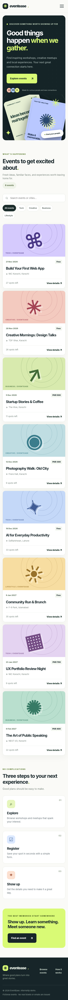
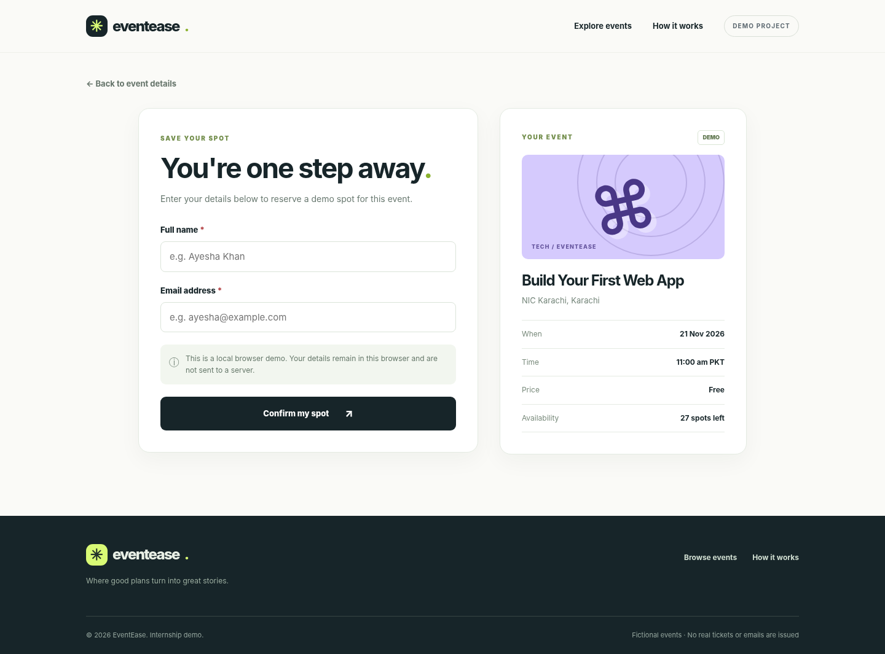
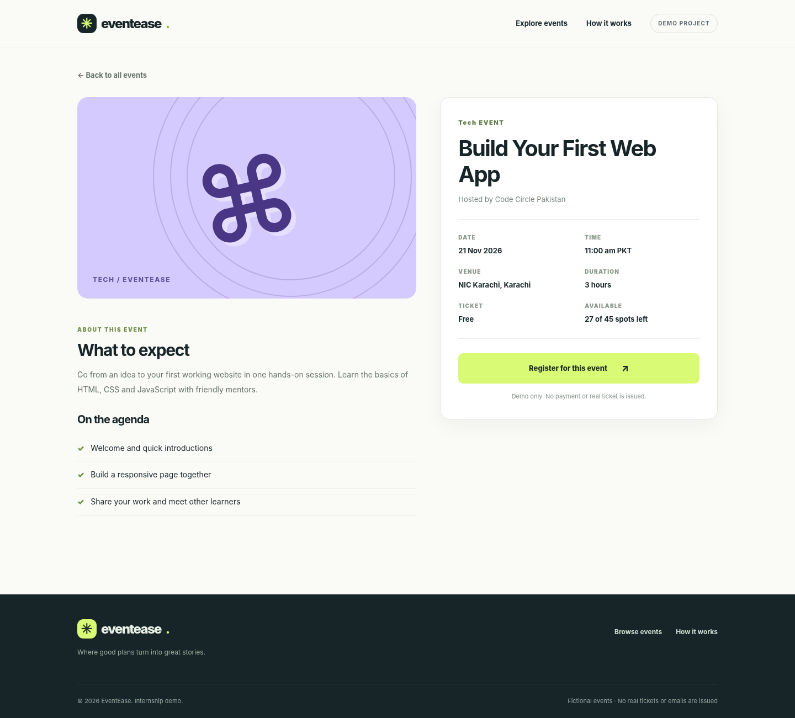
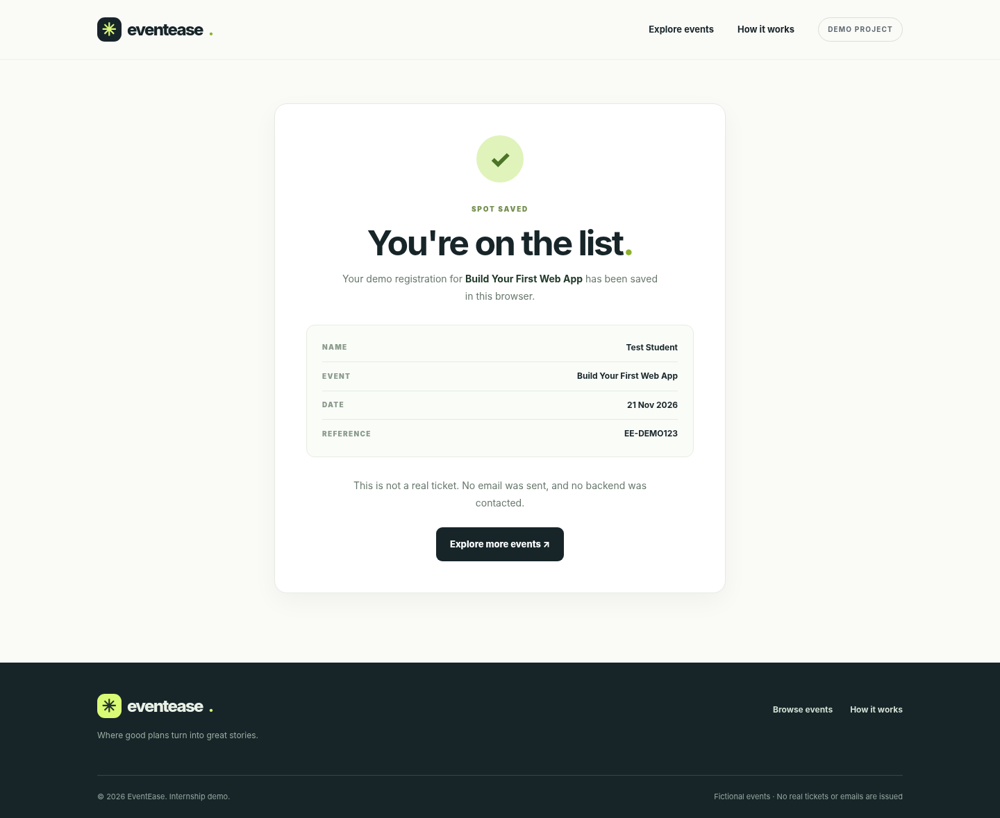

# Week 2: Frontend foundation

## Internship requirements

- [x] Build the main UI with responsive layout
- [x] Provide navigation across pages
- [x] Use reusable frontend components (`assets/js/components.js`)
- [x] Display realistic **fictional** demo data (`assets/js/data.js`)
- [x] Add responsive desktop and mobile screenshots (in `docs/screenshots/`)
- [ ] Commit changes and screenshots to GitHub (complete after uploading)

## Main screens

1. `index.html` — browse events, search by event/city, filter by category.
2. `event.html?id=1` — event description, schedule, venue and spots remaining.
3. `register.html?id=1` — registration form with browser-side validation.
4. `success.html` — confirmation after a demo registration.

## Reusable components

`assets/js/components.js` holds shared navigation, footer, event card, event artwork, and common date formatting.

## Data source

All 8 event records are fictional examples stored in `assets/js/data.js`. Each contains a title, category, time, city, venue, fee, capacity, organizer and agenda. No API exists yet.

## Demo registration behavior

The form performs basic client-side checks, detects duplicate emails for the same event **in this browser**, and saves demo registrations using `localStorage`. The confirmation page displays data for the most recent registration in the tab. No emails are sent, no payments are processed and no real booking occurs.

Client-side storage is **not** an acceptable substitute for the planned production backend, including server-enforced data validation, duplicate detection, capacity handling, and personal data protection. Replace it with the API in a later week.

## Running the demo

Open the folder in VS Code and use Live Server to launch `index.html`, **or** run `python -m http.server 8000` from the project folder and open `http://localhost:8000`.

Do not launch the HTML with `file://` because this project uses JavaScript modules. No npm dependencies are needed.

## Screenshots

- 
- 
- 

## Next milestone

Build `/api/events`, `/api/events/:id`, and `POST /api/events/:id/registrations` and replace the hardcoded data/localStorage with real API calls.
- 
- 
