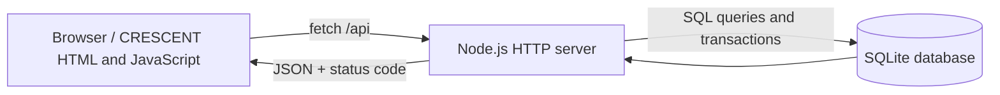

# Week 3: Backend API implementation

> Deployment update: Vercel now has a function entry point and a PostgreSQL adapter; local SQLite remains available. See [Vercel deployment and migration](vercel-deployment.md) for current storage, organizer authorization, booking receipt tokens, setup and verification. The implementation notes below describe the original local Week 3 milestone; statements about unauthenticated booking lookup are superseded by that guide and the root README.

## What changed

- Added a Node.js HTTP server at `server/index.js` that serves the same frontend and the `/api/*` REST endpoints on `http://localhost:3000`.
- Added persistent SQLite storage using the native `node:sqlite` module available in Node.js 22.13+.
- Seeded SQLite with the same 22 fictional demo events as the existing CRESCENT frontend.
- Added REST routes for event listing, detail, event creation, simple registration, demo ticket booking, booking lookup, and health.
- Added server-side validation, size and content-type restrictions, structured errors, and atomic transactions for inventory updates.
- Updated the checkout and organizer pages to submit to the API. Frontend booking summaries remain cached in browser storage for the existing My Tickets UI.
- Added API integration tests in `tests/api.test.js`.

## Architecture



## How to run

You must use **Node.js 22.13 or newer**. Native SQLite is experimental in Node 22, so a warning may appear when the server starts. That warning is expected.

From the project root in VS Code:

```powershell
node --version
npm.cmd run dev
```

Open `http://localhost:3000` instead of Live Server. The API and frontend now share one origin. To view API responses directly, open:

- `http://localhost:3000/api/health`
- `http://localhost:3000/api/events`
- `http://localhost:3000/api/events/after-hours`

Test all backend and existing frontend logic with `npm.cmd test`.

## REST endpoints

All endpoints are implemented and documented with request and response formats in the project root `README.md`.

| Method | URL | Response |
| --- | --- | --- |
| GET | `/api/health` | 200 API status |
| GET | `/api/events` | 200 list; optional `q`, `city`, `category` query filters |
| GET | `/api/events/:id` | 200 event + ticket pools; 404 missing |
| POST | `/api/events` | 201 new demo event; 422 invalid fields |
| POST | `/api/events/:id/registrations` | 201 registration; 409 duplicate/full/ended |
| POST | `/api/bookings` | 201 booking; 409 sold-out/ended |
| GET | `/api/bookings/:reference` | 200 booking; 404 missing |

All errors have the same structure: `{ "error": { "code": "...", "message": "...", "details": [...] } }`. The `details` array is present for field validation failures.


## Persisted database entities

| Table | Important fields | Purpose |
| --- | --- | --- |
| `events` | `id`, `title`, `date`, `venue`, `city`, `capacity`, `price`, `category` | Seeded and newly created events |
| `registrations` | `id`, `event_id`, `full_name`, `email`, `created_at` | Simple registration with unique email per event |
| `bookings` | `id`, `event_id`, `name`, `email`, `phone`, `payment`, `subtotal`, `fee`, `total` | Demo booking details |
| `booking_items` | `booking_id`, `type`, `quantity`, `price` | Purchased ticket tiers for each booking |

One event can have many registrations and bookings. Each booking can contain up to three ticket types. Booking inventory and simple registration seats are checked together. All writes use parameterized SQL.

## Server-side enforcement

- Names must be 2 to 100 characters; emails must use basic email syntax and be at most 150 characters.
- Booking phones need 7 or more digits and use supported punctuation only.
- Event titles/descriptions/city/venue/host have length bounds; dates must be in the future.
- Event capacity is 1 to 100,000; PKR base ticket price is 0 to 1,000,000.
- Booking must contain 1 to 3 unique ticket types, with 1 to 10 tickets per type and a maximum of 10 total.
- The server calculates prices and the rounded 5% fee; it ignores any client-supplied price.
- A SQLite `BEGIN IMMEDIATE` transaction serializes booking and registration inventory checks and inserts. Bookings and simple registrations share the same overall seat inventory.
- Email addresses are normalized to lowercase before enforcing uniqueness per event for simple registrations.
- JSON requests above 64 KiB or with incorrect content types are rejected.

## Limitations (internship demo only)

- This backend runs locally and accepts no real payments; ticket references are not valid for admission.
- Organizer event creation and booking lookup have **no login or access controls**. Keep this server on localhost; do not deploy it publicly with personal data.
- The frontend still keeps a local booking cache for the confirmation and My Tickets pages and uses demo event records for initial rendering. The backend is the authority for submitted booking price, registration and inventory. Live ticket counts on the frontend may be outdated until a refresh and are checked again on booking submission.
- Cover images selected in the organizer are retained as a local browser preview. The server currently assigns a default cover rather than uploading file content.
- Real products require authentication, authorization, payment integration, rate limiting, secure credentials, database backups, event image storage, and personal data protection.

## Verification performed

`node --test tests/*.test.js` passed the existing seven frontend tests and eight backend tests. Backend tests cover valid event creation and lookup, invalid input, duplicate simple registration, booking totals, inventory depletion, malformed JSON, invalid media type, oversize bodies, method rejection, static file exposure, and concurrent contention on the final registration seat.
