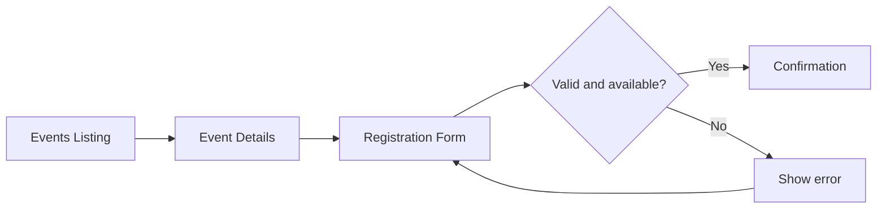

# Week 1: Screen sketches (low-fidelity wireframes)

These sketches show rough layout and navigation, not finished UI designs.

## Screen 1: Events listing
```text
+---------------------------------------------------+
| EventEase                           Events         |
+---------------------------------------------------+
|                 Upcoming Events                   |
|                                                   |
| +-------------------+  +------------------------+ |
| | Coding Workshop   |  | Career Meetup          | |
| | Dec 12, 2026      |  | Dec 19, 2026           | |
| | Karachi           |  | Karachi                | |
| | [View Details]    |  | [View Details]         | |
| +-------------------+  +------------------------+ |
+---------------------------------------------------+
```

## Screen 2: Event details
```text
+---------------------------------------------------+
| EventEase                           Back to Events|
+---------------------------------------------------+
| Coding Workshop                                   |
| Date: Dec 12, 2026                               |
| Location: Karachi                                 |
| Seats available: 25                               |
|                                                   |
| Learn practical web development skills.           |
|                                                   |
|                    [Register Now]                 |
+---------------------------------------------------+
```

## Screen 3: Registration form
```text
+---------------------------------------------------+
| EventEase                                         |
+---------------------------------------------------+
| Register for: Coding Workshop                     |
|                                                   |
| Full Name                                         |
| [____________________________________]            |
|                                                   |
| Email Address                                     |
| [____________________________________]            |
|                                                   |
|             [Submit Registration]                 |
|                                                   |
| Error message appears here if needed.             |
+---------------------------------------------------+
```

## Screen 4: Confirmation
```text
+---------------------------------------------------+
| EventEase                                         |
+---------------------------------------------------+
|                   Registration successful!        |
|                                                   |
| You're registered for Coding Workshop.            |
| A confirmation is shown on screen.                |
|                                                   |
|                 [Back to Events]                  |
+---------------------------------------------------+
```

## Navigation flow


Note: The event names, dates, and seat counts are mock data for planning only.
